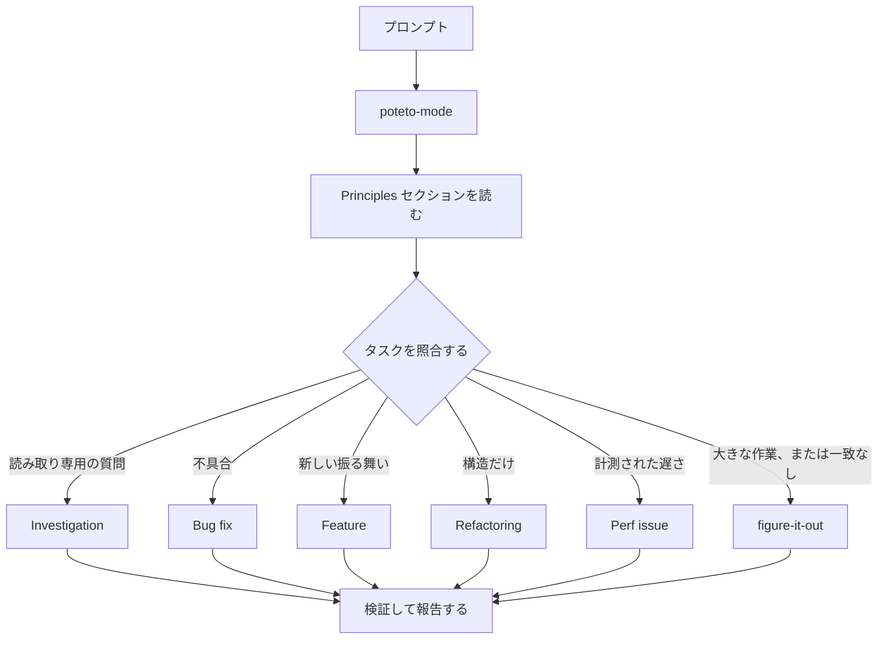

# 作業を `/poteto-mode` に振り分ける

`/poteto-mode` は玄関口です。ゴールを渡すと、23 個のプレイブックから 1 つを選び、そのプレイブックの手順を todo リストにコピーし、手順が必要とするスキルを呼び出します。このページでは、良いプロンプトとはどんなものか、そして実際にどれだけ短くて済むのかを学びます。


## プロンプトはどう処理されるか



この図はよくある経路を示しています。ほかにも、指標を登り改善する（hillclimbing）、実行時の症状や取得したトレースを診断する、プロトタイプ、見た目の一致、スキルの作成と評価、自律実行、PR を開く、PR やスタックをマージできる状態まで見守る、検証済みのスタックを出荷する、PR キューやスタックを自動操縦で回す、プロジェクト規模のプログラムを編成する、セッションの引き継ぎ、安全に一時停止する、多段階の計画、ワークツリーの片付け、といったプレイブックがあります。[プレイブックのディレクトリ](../../skills/poteto-mode/playbooks/) に全一覧があります。

## 作法ではなくゴールを語る

仕様は書きません。何がおかしいか、何がしたいかを伝え、それに加えてエージェントの時間を節約できる既知の情報を添えます:

```text
/poteto-mode users get two notifications after a retry. repro first, then fix and verify.
```

これは Bug fix のプロンプトです。「repro first」は礼儀ではなく実際の制約で、プレイブックはそれを守ります。todo リストが Bug fix の手順で埋まっていくのを見てください。スキップした手順も `skip: <reason>` を付けて残ります。

## プロンプトに入れるもの

役に立つプロンプトは最大 5 つの要素を持ち、どれも 1 文に収まります:

- **ゴール。** 何がおかしいか、何がしたいかを言います。
- **合格条件。** 合否を判定できるものでなければなりません。「もっと良くして」や「1 時間取り組んで」は条件になりません。
- **見たい証拠。** 実際のコマンド出力、フローの動画、保存された値、変更前後の数値を求めてください。
- **すでに分かっていること。** 症状、再現手順、ログの 1 行、リンクがあれば、エージェントの調査を 1 回分省けます。
- **実際の制約。** 「repro first」「don't change any code yet」「zero behavior change」「let me review before proceeding」は、それぞれエージェントの行動を変えます。

5 つすべてを含むプロンプトがこちらです:

```text
/poteto-mode the csv export drops its last row since yesterday's deploy. failing job id is 4812. repro first, then fix. done means the 60k-row fixture exports every row. show me the row counts before and after.
```

省いたほうがよいものが 2 つあります:

- **やり方。** 達成したいことを言い、自分なら選ぶより良い道をエージェントが見つけられる余地を残します。スキルの一覧も同じで、下の落とし穴で扱います。
- **最初のうちは、原因についての自分の説。** 推測を口にすると、探す範囲が指し示した先だけに狭まります。自分の直感を共有する前に、エージェントに問題を言い直させましょう。

長いスレッドや漠然としたバグ報告のような、ノイズの多い報告では、言い直しを最初の手順にします:

```text
/poteto-mode read this thread. restate the underlying issue in your own words, in plain english. don't change any code yet.
```

読み違いは、コードがまだ存在しない言い直しの段階で表に出ます。そこで直せば、間違った修正 1 回ではなく、メッセージ 1 通で済みます。プレイブックを使わず言い直しだけをしたい場合は、[`/in-your-own-words`](../../skills/in-your-own-words/SKILL.ja.md) を実行します。エージェントがあなたのゴールをどう理解しているか、どんな問題を解こうとしているかを言い直します。

プロンプトの狙いが合っているか自信がないときは、送る前に [`/sharpen`](../../skills/sharpen/SKILL.ja.md) をかけます:

```text
/sharpen write a migration guide for the v2 config format.
```

エージェントは、一流の専門家なら頼まれなくてもやることを挙げ、その人が最初に使う最も生の材料、使う手法とツール、あなたやエージェント以外の何が結果の正しさを示すかを述べます。そのうえで、まさにそれを求める形にプロンプトを書き換えます。深くなりますが、大きくなりません。あなたの選択肢は開いたままです。タスク自体は実行しません。書き換えを読んでから、たとえば `/poteto-mode` で送ってください。

## 追加の指示は短く

会話がすでにコンテキストを運んでいるなら、プロンプトはほぼ何も残りません。次のどれでも足ります:

```text
/poteto-mode do it
```

```text
continue
```

```text
keep going until done
```

短くても効くのは、構造をプレイブックが持ち、カスタムモードが `/poteto-mode` を毎ターンコンテキストに残すからです。開始方法は [pstack をセットアップする](01-setup.ja.md) で説明しています。意図はあなたの言葉が運び、厳密さはスキルが運びます。

## 「new task」でタスクを切り替える

長いチャットは前のタスクのコンテキストを溜め込みます。話題を変えるときは、そう告げてください:

```text
/poteto-mode new task. figure out why the cache entry survives logout. don't change any code yet.
```

「new task」は、前のプレイブックを続けるのではなく、マッチし直すよう `/poteto-mode` に伝えます。「don't change any code yet」はこれを Investigation に固定します。この 2 つのフレーズがないと、Feature の途中にあるモードは、あなたの質問を機能追加の次の手順として扱いがちです。

## 並行作業には専用のマシンを渡す

1 台のコンピュータで 1 つのリポジトリに対して複数のエージェントを動かすと、作業ツリー、ポート、ビルド出力を奪い合います。最もきれいに分離できるのは [クラウドサブエージェント](https://cursor.com/docs/subagents#cloud-subagents) です。それぞれが専用の VM とブランチを持つので、あなたのマシンに触れずに依存関係をインストールし、アプリを実行し、結果を動画に収められます。タスクの前に `/in-cloud` と入力するか、親チャットにクラウドサブエージェントへ作業を渡すよう頼みます。

作業をローカルに留める必要があるときは、最初にワークツリーを要求します:

```text
/poteto-mode new task. branch off <base> in a fresh worktree, then port the parser change there.
```

タスクごとに専用のブランチとワークツリーがあれば、あるエージェントが別のエージェントのファイルを踏み荒らすことはありません。ワークツリーはディスクとマシンのリソースを食うので、ラップトップでは同時に数個しか動かせません。[PR を開くプレイブック](../../skills/poteto-mode/playbooks/opening-a-pr.ja.md) はコード変更についてはすでにワークツリーから動くので、ふだんこれを言うのは、特定のベースや場所が重要なときだけです。

ワークツリーは溜まっていきます。ディスクが厳しくなったら、こう頼みます:

```text
/poteto-mode what's eating my disk? prune the worktrees that are safe to prune.
```

[ワークツリー片付けプレイブック](../../skills/poteto-mode/playbooks/worktree-cleanup.ja.md) は、すべてのワークツリーを、マージ状態、未コミットの作業、まだ触っているチャットで分類します。その証拠で片付くと確認できたものだけを削除し、未コミットの作業を抱えているものはあなたの判断のために一時停止します。

## 動かしたまま離れる

席を外すときは、何をもって完了とするかを伝えてから離れます:

```text
/poteto-mode im stepping away. keep going until the migration check reports zero old callers. log your decisions.
```

後でレビューする作業は [`/figure-it-out`](../../skills/figure-it-out/SKILL.ja.md) を経由します。これは実行のフェーズを設計し、[`/show-me-your-work`](../../skills/show-me-your-work/SKILL.ja.md) の決定ログを残します。夜間の契約の全体は [寝ている間に作業を進める](07-overnight.ja.md) で扱います。

**落とし穴:** プロンプトにスキルを列挙しないでください（「use /how, then /architect, then /arena...」）。プレイブックがすでに順序を決めており、手書きの順序はたいてい、プレイブックなら残したはずの手順を並べ替えたり落としたりします。スキル名を挙げるのは、特定の選択を上書きしたいときだけです。

振り分けのルール全体は [`poteto-mode`](../../skills/poteto-mode/SKILL.ja.md) 本体を読んでください。

次: [コードを理解する](03-understand.ja.md)。
