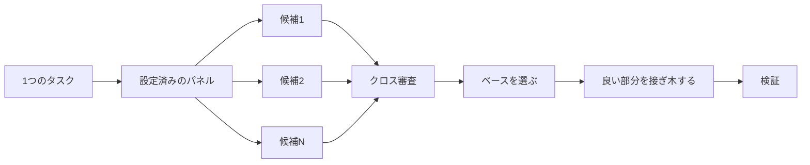

# コードを書く前に設計する

難しい設計を一度の試行で済ませると、モデルが最初に思いついた形に固定されてしまいます。`/architect` は実装の前に型と境界を決めます。`/arena` は同じお題で複数の試行を走らせ、良いところを統合します。`/interrogate` は他のモデルにその結果を壊させようとします。設計の統合ではなくカバレッジが仕事なら、`/swarm` がスライスやレースを分散させ、結果を集約します。

設計でいちばんよくある失敗は2つです。エージェントの最初の設計をそのまま採用してしまうことと、コードで試されていない計画を磨き上げてしまうことです。このページはその両方を直します。計画はコードを通して立てます。未解決の問いにはプロトタイプが答え、README やチュートリアルが目標を定め、書かれた計画は最後に作ります。


## `/architect` で形を決める

```text
/architect design the import pipeline before writing any code. i care most about how callers use it.
```

[`/architect`](../../skills/architect/SKILL.ja.md) はまず足場を固めます。設計が触れるコードに対して `/how` を実行し、所有権やレイヤーを動かす場合は `/why` を実行します。そのうえで `/arena` を走らせ、競合する設計スケッチを作ります。各スケッチには呼び出し側の使い方が最初に書かれ、続いて型、シグネチャ、モジュールマップが並びます。

既定では、統合された設計からそのまま実装に進みます。先に設計を見たい場合は、そう伝えてください。

```text
/architect with checkpoint. stop and show me before implementing.
```

コードを書き始めたら、設計は神聖なものではありません。実装してみると無関係な場所で同じワークアラウンドが出てくる、あるいは `any` や強制キャストでしかコンパイルできない型が出てくるなら、`/architect` はそれを設計が間違っている証拠として扱います。スケッチを捨て、場当たり的にパッチを当てるのではなく最初からやり直します。

## `/arena` で試行を分散する

```text
/arena take my prompt to the arena verbatim. i want to compare their proposals with yours.
```

[`/arena`](../../skills/arena/SKILL.ja.md) はその土台にある汎用ツールです。N 個のサブエージェントが同じ設計やコードのお題に並行して取り組み、それぞれが自分のワークツリーかディレクトリに書きます。別のモデルファミリーから来た読み取り専用の審査役が、ルーブリックに照らして全候補を採点します。別ファミリーのモデルを動かせない場合、コーディネーターは審査役を飛ばして自分でベースを選びます。コーディネーターは各候補を端から端まで読み、ベースを1つ選び、負けた候補の良いアイデアを接ぎ木し、結果を検証します。



パネルは [`/setup-pstack`](../../skills/setup-pstack/SKILL.ja.md) の設定から作られ、タスクごとに調整できます。判断が重要なときは候補を増やし、そうでないときは減らしてください。

```text
/arena this, 5 candidates. the cache key format is expensive to change later.
```

## `/swarm` でスライスとレースをカバーする

```text
/swarm check every package under packages/ against its check.sh. one worker per package. one report.
```

[`/swarm`](../../skills/swarm/SKILL.ja.md) は N 個のワーカーを、独立したスライス、カバレッジマトリクス、ガントレットのレーン、探索のパーティション、宣言済みのレースの腕（arm）に分散します。各ワーカーは自分のスコープとチェックを受け取り、`PASS`、`ISSUES`、`BLOCKED` のいずれかを報告します。親はワーカーを待ち、抜けや脱落があればそれも含めて1つの簡潔なレポートを返します。

並列化でカバレッジを稼げるとき、あるいは独立したチェックを競わせたいときに使います。`/arena` は全ワーカーに同じ設計やコードのお題を与え、ベースを選んで良い部分を接ぎ木します。`/swarm` はスライスをカバーするか、選択ルールをあらかじめ宣言したレースを走らせます。ベース選択と接ぎ木の儀式は行いません。

## `/interrogate` で壊してみる

```text
/interrogate the whole branch, but skeptically. no nitpicks unless it's an actual bug or regression.
```

[`/interrogate`](../../skills/interrogate/SKILL.ja.md) は変更内容とその意図を、設定済みモデル上の敵対者に渡します。敵対者はそれぞれ、実際のコードに対して実行して壊そうとします。見つかる失敗は敵対者ごとに違います。指摘が生き残るのは、そのコマンドを再実行して意図を壊す失敗が示されたときだけです。レポートには、検証済みの指摘がすべて、それを見つけた敵対者とともに並び、続いて各敵対者が何を落としたかとその理由が示されます。何も適用はしません。

Dropped のリストも読んでください。判定は覆せます。

## 議論する代わりにプロトタイプする

最初の設計をそのまま採用しないでください。いくつか出させて、目に見える証拠から選びます。

```text
/poteto-mode prototype a few options for the new dropdown menu. take screenshots or videos for me to compare.
```

[Prototype プレイブック](../../skills/poteto-mode/playbooks/prototype.ja.md) はスクラッチディレクトリに使い捨てのスケッチを作り、バリアントを1つのスイッチャーの裏に置き、それぞれを動かしてスクリーンショットやタイミングを記録します。UI だけでなく、振る舞いやアルゴリズムにも使えます。プロトタイプはコードでの計画です。エージェントはあなたに聞く代わりに何かを実行して、自分で未解決の問いに答えられます。あなたが思いつかなかった選択肢の余地も残ります。

同じ考え方は実際の設計にも広げられます。`/architect` とプロトタイプを組み合わせ、レビューのゲートを挟みます。

```text
/poteto-mode we need rate limiting for external webhooks. /architect it first, and answer open questions with prototypes. let me review before proceeding.
```

抽象的な計画に敵対者を使うのはやめましょう。`/interrogate` は実行で証明できない指摘をすべて落とすので、コードの裏付けがない計画では壊せるものがほとんどありません。問いはプロトタイプに決めさせ、できあがったものをレビューしてください。

## 共有コードでは README を先に書く

他のコードが使うパッケージや API では、利用者が読むドキュメントから始めます。

```text
/poteto-mode write a tutorial for how i would use the new config package first. then /teach me why it beats the current one.
```

チュートリアルを先に書くと、呼び出し側の視点が強制されます。架空の利用者に API を説明し、そこから実装へと逆算します。このドキュメントは、エージェントが自分の作業を照らし合わせる具体的な目標にもなります。ドキュメント自体が重要なときは [`/technical-writing`](../../skills/technical-writing/SKILL.ja.md) を名指ししてください。チュートリアルがリファレンスと説明を同時に兼ねるものへ漂流せず、チュートリアルのままでいられます。

## 設計が落ち着いてから計画する

pstack には計画用のスキルがありません。これは意図的です。書かれた計画が欲しいときは、設計が落ち着いてから頼んでください。

```text
/poteto-mode turn this design into a plan. small verifiable PRs, each with its own verification steps.
```

[Multi-phase plan プレイブック](../../skills/poteto-mode/playbooks/multi-phase-plan.ja.md) は残った未解決の問いをプロトタイプで決め、PR ごとに1セクションを書き、各セクションを変更が機能する証拠で締めます。テストスイートが通るだけでは、その証拠にはなりません。成果物は計画です。このプレイブックは計画を実装せず、次にどの実行プレイブックが担当すべきかを名指しします。

移行作業では、合格ラインをプロンプトに書きます。

```text
/poteto-mode plan the migration of our ui library to the new styling system. small verifiable PRs, each with visual regression checks. the result must match the original exactly, bugs included.
```

「バグも含めて」と書くことで、移行の途中でこっそり不具合を直してしまい、新旧の出力を比較できなくなるのを防げます。何日にもわたるプロジェクトなら、計画をしばらくリポジトリにコミットして、他のエージェントに進行中の作業が見えるようにしても構いません。作業が取り込まれたら削除します。

## タスクにどれだけ設計をかけるべきか

すべての変更にこれが必要なのか、疑問に思うかもしれません。答えはいいえです。ほとんどの変更には何も要りません。おおまかな段階はこうです。

- 小さくて完了している変更に自信が持てないなら、`/interrogate` だけで足ります。
- 関数の境界をまたぐ変更や所有権を動かす変更には `/architect` がふさわしく、`/arena` も一緒に付いてきます。
- 命名、フォーマット、アルゴリズムなど、独立した試行が効く単独の判断には、直接 `/arena` を使います。
- カバレッジマトリクス、並列チェックの集合、宣言済みの腕を持つレースは `/swarm` です。
- レイアウト、タイミング、アプローチなど、何かを実行すれば答えられる未解決の問いには、議論ではなくプロトタイプを当てます。
- 異論があり、後戻りにコストがかかる設計には `/architect` を使い、出荷前に `/interrogate` をかけます。
- 複数の PR にまたがる作業には計画を作り、設計が落ち着いてから書きます。

`/poteto-mode` はすでにこの段階を適用します。境界をまたぐ作業は自動的に `/architect` を起動するので、これらを直接使うのは、既定より厳しく見てほしいときや、逆に緩く見てほしいときが主です。

次: [変更をビルドして片付ける](05-build-and-clean.ja.md)。
