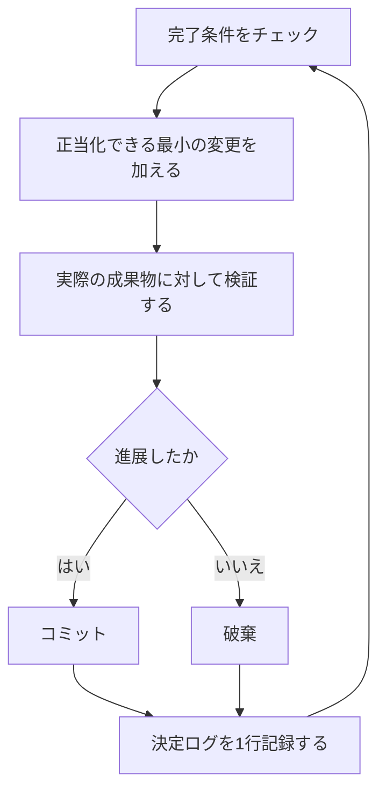

# 寝ている間に作業を進める

ここまでのすべてが、ここで報われます。自分の仕事を検証してくれると信頼できるエージェントは、難しいタスクを任せて放っておけるエージェントです。それを安全にするのは願望ではありません。検証できる完了条件、隔離されたワークツリーまたはクラウドエージェント、そして朝に監査する決定ログです。


## ループを回す前に信頼を勝ち取る

信頼していないループは、検証されていない仕事をより速く生み出すだけで、乱雑さは反復のたびに積み上がります。ループを走らせたままにする前に、信頼に値する状態かを確認しましょう。

- そのタスクを一度は自分の手でやったか、エージェントがやるのを見て、何が良い状態かを知っている。
- エージェントは、あなた自身が使うツールとシグナルを持っている。検証スキル、プロファイラ、ログなど。
- 各段階が自分の仕事を証明し、基準に届かなければラインを止められる。
- いくつかのトランスクリプトを読み、繰り返す失敗をツール、スキル、チェックに変えてある。

4つすべてが満たされてから、ループを自律実行にしましょう。それまでは、見ている間に走らせます。

## 夜間の契約

良い引き継ぎには、ゴール、完了条件、権限、そして逃げ道があります。長くある必要はありません:

```text
/poteto-mode im going to bed. migrate every caller to the new parser in a fresh worktree off <base>.
done means zero old callers, all parser fixtures pass, old api deleted.
keep a decision log. don't ask me before committing.
/loop until done. if you're truly stuck after a few hours, stop and write up why.
```

各行が何をもたらすかを見ていきましょう:

- 「im going to bed」はセッションの上書きです。エージェントは質問をやめて、進み続けます。
- 「done means...」はゴールを、各反復で実行できるチェックに変えます。
- 「fresh worktree off `<base>`」は、実行が他に開いているものと衝突しないようにします。
- 「don't ask me before committing」は、エージェントが止まりかねない権限の問いに先回りして答えます。
- `/loop` は pstack のスキルではなく、Cursor 組み込みの、エージェントを起こし直す仕組みです。[Autonomous run プレイブック](../../skills/poteto-mode/playbooks/autonomous-run.ja.md)はこれを使って、イベントまたはハートビートで完了条件を再チェックします。
- 逃げ道があると、本当に行き詰まったときに止まって理由を書き出せます。8時間にわたってゴールを創造的に再解釈し続けるよりましです。

離席したあとにこの仕事をレビューすることになるので、`/poteto-mode` はこれを [`/figure-it-out`](../../skills/figure-it-out/SKILL.ja.md) に通します。これはコードを書く前に実行のフェーズを設計し、決定ログを組み込みます。

意図的に実行を止めるには、一時停止するよう伝えるか、まもなくオフラインになる、あるいは Cursor を再起動すると伝えます。[Pause safely プレイブック](../../skills/poteto-mode/playbooks/pause-safely.ja.md)は、現在のステップを終えるか取り消し、作業中のチェックポイントをコミットし、再開用のメモを書きます。新しいチャットは、Session pickup プレイブックを通じてそのメモから作業を引き継ぎます。「keep going」と言っても一時停止は起きません。

## ループが一晩じゅう行うこと



1回の反復で、変更1つ、チェック1つ、ログ1行。役に立たなかった変更は破棄され、そのまま居座ることはありません。停滞は停止ではなく方向転換の合図ですし、完了条件がこっそり緩んで勝利宣言になることもありません。

## 朝の監査

[`/show-me-your-work`](../../skills/show-me-your-work/SKILL.ja.md) が、実行をレビューできるものにします。各行には時刻、フェーズ、決定、理由、証拠へのポインタ、結果が記録され、`decisions.tsv`（複数の実行が同じディレクトリを共有する場合は `.audit/<task-slug>.tsv`）という TSV に保存されます。既定ではローカルに留まります。レビュアーが結果を信頼するのに記録の流れを必要とするほど野心的な仕事なら、コミットしましょう。

戻ってきたら、レビュー用の形で実行を尋ねます:

```text
/show-me-your-work catch me up on what you did last night
```

スキルが要約を返す前に、別のモデルファミリーのレビュアーを起動して記録とトランスクリプトを読ませます。返信の最後には Attention セクションがあり、あなたが精査すべき点が並びます。まずそのセクションを読み、次にそれが指すログ行を読みます。あなたが監査するのは判断であって、一晩のすべてを読み直すわけではありません。

監査ではなく手早い状況確認が欲しいときは、作業を実行したチャットで [`/ketchup`](../../skills/ketchup/SKILL.ja.md) を実行します。読み取りだけを行い、最後のメッセージ以降に何が変わったかを平易な言葉で伝え、その作業が生んだスクリーンショットや小さな図を添えます。続いて、マージや承認、選択肢のどれを選ぶかなど、あなたの判断待ちの案件を、その推奨、証拠、リスクとともに列挙するので、返信だけで判断できます。

## 夜の仕事が単一のタスクではなくキューであるとき

上の契約は、1つのタスクを1つの完了条件まで進めます。もっと多くを抱える夜もあります。独立した変更のキューや、プログラム全体です。3つのプレイブックが、同じ信頼をより大きな規模に広げます。

[Autopilot-full](../../skills/poteto-mode/playbooks/autopilot-full.ja.md)は、独立した PR のキューをマージまで進めます。各 PR にはオーナーエージェントが1体付き、ビルドからマージまでを担います。オーナーが自分の判定だけでマージすることはありません。新しい検証者の群れが、オーナーがコードを書き終えたヘッドをチェックします。後からの rebase や軽微な修正には新しい検証者が1体付き、新しい振る舞いや大きな新しい diff のときだけ、再び群れ全体が呼ばれます。マージされるパッチに対するクリーンな判定だけがマージを許可します:

```text
/poteto-mode full autopilot on this queue. each item is independent. i want them merged by morning.
```

[Autopilot-stack](../../skills/poteto-mode/playbooks/autopilot-stack.ja.md)は、マージなしの Autopilot-full です。目覚めると検証済みの PR が並び、それぞれに判定が付いています。自分でレビューして取り込みます。PR は、それが積み上がる元の PR の上にだけスタックします。何かがマージされる前に自分の目で仕事を見たいときは、Autopilot-full ではなくこちらを選びます:

```text
/poteto-mode autopilot these five changes, but don't merge. i'll land them in the morning.
```

[Orchestrate](../../skills/poteto-mode/playbooks/orchestrate.ja.md)は、単一のエージェントより長く続くプログラム向けです。数日にわたり、多くの PR がスタックし、常設のコーディネーターチャットの下でサブエージェントの艦隊が動きます。コーディネーターは、どの作業をどのエージェントが担当するかを決め、各エージェントの成果をチェックし、自分ではコードを書きません。1体のエージェントが1セッションで終えられる仕事なら、プレイブック自身が上の夜間の契約へ案内します:

```text
/poteto-mode orchestrate the store migration. own it until every package is converted and merged. i'll check in twice a day.
```

## 多数のプロジェクトを並行実行する

[Cursor Project](https://cursor.com/blog/projects)は、1体のコーディネーターエージェントに永続的なスレッドを与えます。コーディネーターはコードを書きません。サブエージェントに指示を出し、サブエージェントは既定でクラウドで動くので、ノート PC を閉じても作業は続きます。これは Orchestrate プレイブックが想定する形です。コーディネーターへのプロンプトを `/poteto-mode` で始めれば、そこから生まれるサブエージェントはプレイブックに従います。

いくつかの習慣が助けになります:

- 作業のまとまりごとに独自の Project を与えます。機能、マイグレーション、パフォーマンス改善、技術的負債の整理などです。複数を並行して走らせられます。
- 関連するチャットは、終わったものも含めて Project にドラッグします。それらはその Project のすべてのエージェントのコンテキストになります。
- 各 PR をマージ前に検証の群れに通し、キューは Autopilot-stack か Autopilot-full に任せます。
- コーディネーターにはデータに裏付けられた計画を求め、あなたに聞く前に、未解決の問いをプロトタイプで答えさせます。

1つのプロンプトで、調査から実行まで Project 全体を運べます:

```text
/poteto-mode refactor this repo so its architecture is more agent friendly. use /correct and /architect on past commits and review comments to find the mistakes agents make most here. use /recall for context from past chats. answer open questions with prototypes instead of asking me. come back with a plan backed by real data. once i approve it, run it with autopilot-stack or autopilot-full, and ask me which.
```

## ループに自分で始めさせる

上のどのループも、あなたが開始するのを待っています。スケジュール実行やイベント駆動の自動化は、その一手間をなくします。ソフトウェア保守は、これに向いた段階に分かれます。レポートをトリアージし、再現し、修正し、修正を検証する、という流れです。そうしたラインを信頼できるものにするルールが2つあります:

- 各段階がラインを止められます。トリアージはレポートを想定内の挙動と判断でき、再現は再現に失敗でき、修正担当は変更をリスクが高すぎると判断できます。これらの結果はどれも有用です。悪い仕事が次の段階に進むのを防ぎ、そこで取り消す方が高くつくからです。
- 各段階が証拠を引き継ぎます。再現は壊れた状態のスクリーンショットと動画を添え、修正はビフォーアフターの証明を添えます。そうすれば人間は、コードを1行も読む前に、エージェントが正しいものを直したかを確認できます。

pstack はこれを、Slack の issue レポート向けの休眠中の[自動化パック](../../automations/benny/README.ja.md)として同梱しています。1つの自動化が各レポートをトリアージします。もう1つは確認済みのバグを再現し、小さな修正のドラフトを用意することもあります。エージェントに [`FOR_AGENTS.md`](../../automations/benny/FOR_AGENTS.ja.md) を読ませ、対象リポジトリを指定すればセットアップできます。

**落とし穴:** 時間は完了条件ではありません。「4時間これに取り組んで」では、エージェントがチェックできるものが何もなく、目覚めると、成果ではなく4時間分の動きだけが残っています。`/loop` には合否を判定できる述語を渡しましょう。

次: [原則名で方向を変える](08-principles.ja.md)。
